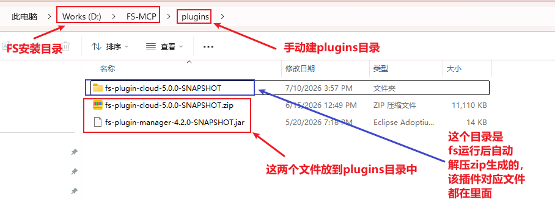
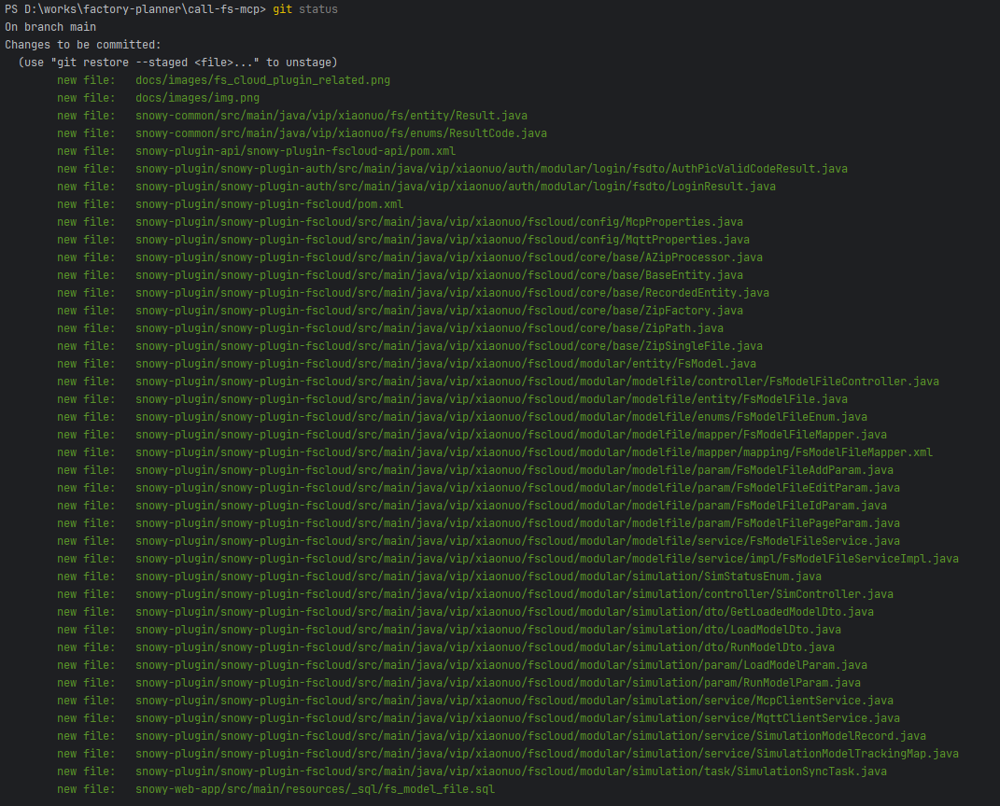
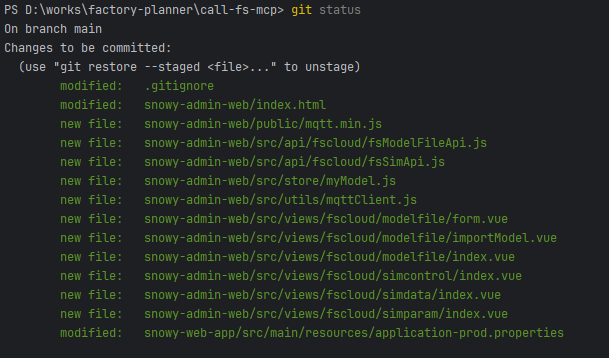
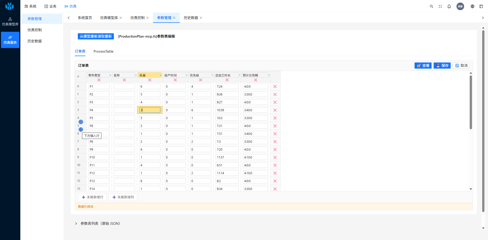
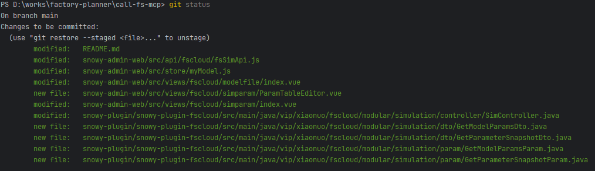

## 1 开发者必读
### 1.1 读框架文档
https://xiaonuo.vip/doc?catalogueId=1574674577108783105&menuId=1574676642119831554&lineIndex=1 按快速启动部分运行代码

### 1.2 mysql数据库名和端口号用户密码约定
- 数据库名：fp_mysql
- 数据库编码：utf-8
- mysql版本：8.0
- 端口号：
  - prod: 3306
  - test: 13306
- 用户名：root
- 密码：rootpassword

### 1.3 redis的安装和运行
- 较新版本
- 免密码

注： 建好数据库库后，按快速启动的方法导入数据库脚本，然后启动前端和后端代码

## 2. 框架介绍
详见 [SNOWY.md 框架介绍](./SNOWY.md)
## 3. ChangeLog 维护规则

## 4. 开发日志
### 4.1 接口测试代码
测试代码主要用于测试MCP接口和MQTT接口，以及如何使用这两类接口开发应用，供开发者参考。
#### 4.1.1 MCP接口测试代码
- 代码：snowy-web-app/src/test/java/fs/McpClientTest.java
- 依赖包： (snowy-web-app/pom.xml) 
  - fastjson2
- 模型文件：snowy-web-app/src/test/resources/step-by-step.fs
- 测试代码运行步骤：
  - 运行fs-mcp5.1.0版 （可作桌面端也可作服务端）
  - 运行mqttx、连接fs-mcp的内置mqtt broker、订阅主题：factory/sim/+/+/+
  - 在IDEA(或其它IDE)中运行McpClientTest.java测试代码(代码有main方法，直接运行即可)，如果一切顺利，可以在mqttx中看到订阅主题的消息，且IDEA控制台中打印出测试代码调试信息。
- 注： docs/McpClientTest.log.md 中记录了测试代码运行的调试信息、MQTTX的订阅主题消息，供开发者参考。
#### 4.1.2 MQTT接口测试代码
- 代码：snowy-web-app/src/test/java/fs/MqttClientTest.java
- 依赖包：snowy-web-app/pom.xml 
  - org.eclipse.paho.client.mqttv3
- 测试代码运行步骤：
  - 运行fs-mcp5.1.0版 （可作桌面端也可作服务端）
  - 运行mqttx、连接fs-mcp的内置mqtt broker、订阅主题：factory/sim/+/+/+
  - 在IDEA(或其它IDE)中运行MqttClientTest.java测试代码(代码有main方法，直接运行即可)，如果一切顺利，可以在mqttx中看到订阅主题的消息，且IDEA控制台中打印出测试代码调试信息。
- 注： docs/MqttClientTest.log.md 中记录了测试代码运行的调试信息、MQTTX的订阅主题消息，供开发者参考。

### 4.2 建立模型库
#### 4.2.1 数据库表fs_model_file导入
- 在navicat中将贵航项目的fs_model_file表导出，包含结构和数据
- 导出的文件为：fs_model_file.sql
- 将这个sql文件导入到本项目的fp_mysql数据库中，数据库新增fs_model_file表，其中的数据只是参考，可删除。

#### 4.2.2 fs-cloud-plugin的使用介绍
fs-cloud-plugin是fs建模器的插件，安装了fs（例如fs_Setup_v5.1.0-20260710-1419.exe）之后,在安装目录下创建plugins子目录，并将这两个插件文件放入plugins目录下即可使用：
- fs-plugin-manager-4.2.0-SNAPSHOT.jar
- fs-plugin-cloud-5.0.0-SNAPSHOT.zip

#### 4.2.3 后端支持fs-cloud-plugin的登录
登录相关的文件如下图所示：

#### 4.2.4 后端支持fs-cloud-plugin的模型上传、落盘、落库

### 4.3 取模型中的参数
#### 4.3.1 在fs建模器中定义MCP表
- 在fs建模器中打开模型文件（.fs文件）
- 在主模型中添加MCP表，表名：MCP, 用于MCP接口查询模型中的参数table
- 在MCP表中添加列，名称建议“参数列表|S”
- 将要查询的参数添加到MCP表中: 
  - 选要查询/修改的参数table, ctrl+c
  - 在MCP表中添加一行，添加行后选中新单元格即可（单击鼠标）, ctrl+v 完成添加
- 将模型文件上传到后端，落盘、落库，添加到模型库 （按4.2章节步骤）
#### 4.3.2 在“仿真服务”-“参数管理”中查看和修改参数

#### 4.3.3 代码相对 fb09bf83 版本的变化

